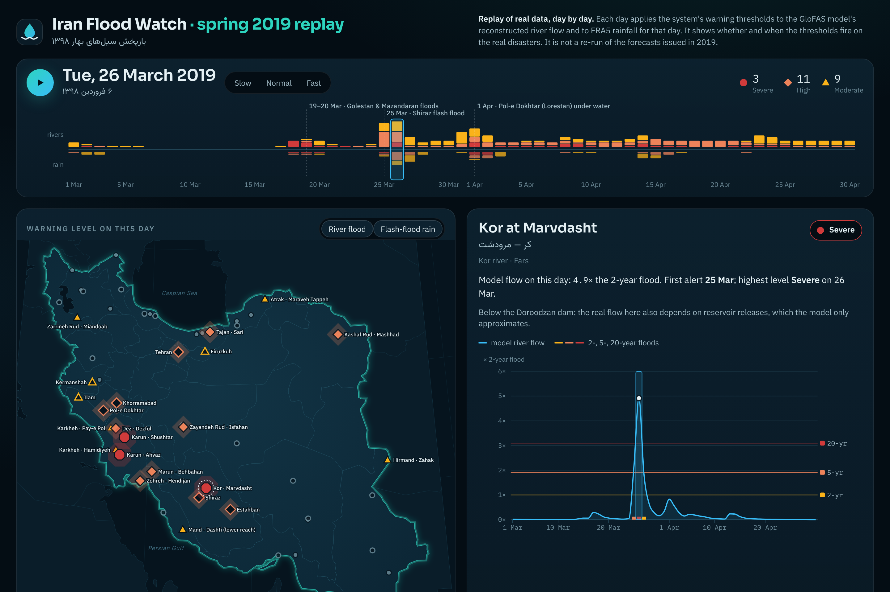

# Iran Flood Watch · پایش و هشدار سیل ایران

A flood early-warning dashboard for Iran, built only from open data. It watches 29 river reaches and 27 flash-flood-prone cities. It updates within about an hour of every new model run and sends an alert as soon as a site reaches a warning level or moves up a level.

[](https://risarezaei.github.io/iran-flood-watch/replay-2019.html#d-2019-03-26)

**Not an official warning service.** Always follow the Iran Meteorological Organization and local crisis-management authorities.

## What it does

| Signal | Forecast | Threshold |
|---|---|---|
| River flood (29 sites) | GloFAS v4 ensemble river discharge, 51 members, 30 days ahead (~5 km river network). New run every day. | 2-, 5- and 20-year flows of the same model's own daily discharge, water years 1997–2024 |
| Flash-flood rain (27 sites) | ECMWF IFS ensemble rainfall, 51 members, 15 days ahead (0.25°), summed over Iran local days and over 3-day windows. New run every 6 hours. | 2-, 5- and 20-year 1-day and 3-day rainfall from ERA5 (0.25°), water years 1992–2024, summed the same way |

Return levels come from a Gumbel distribution fitted by L-moments to water-year (October–September) annual maxima. Each forecast is compared with its own model's climate, the same idea GloFAS uses for its flood signals. Because of that, river flows are shown as multiples of the 2-year flood rather than as raw m³/s.

Warning levels, checked day by day across the alert window (30 days for rivers, 10 days for rain):

- **Severe**: at least 30% of ensemble members above the 20-year level
- **High**: at least 30% above the 5-year level
- **Moderate**: at least 50% above the 2-year level
- **Normal**: none of these

A rain site takes the higher level of its 1-day and 3-day checks, so long, steady rain is caught as well as single downpours. The probabilities, horizons and pacing are all in `CONFIG` at the top of `src/engine.mjs`.

**Timing:**
- The page shows which model runs it used, in Tehran time.
- If a run is older than its normal cycle (48 h for GloFAS, 30 h for the ECMWF ensemble), the page shows an "out of date" banner.
- Each alert lists the day it starts and the day it peaks.

**Event check:** the largest modelled flows since 1997 fall on known disaster dates:
- Gorganrud on 18 March 2019 (the Golestan floods)
- Kor on 26 March 2019 (the Fars floods)
- Karkheh and Seymareh on 1 April 2019
- Sarbaz and Minab on 11 January 2020 (Sistan and Baluchestan)

Sites below large dams are marked, because the real flow there also depends on release decisions.

**Replay demos:** `tools/build-replay.mjs` builds a day-by-day replay of a past flood using the same thresholds and warning rules:
- `docs/replay-2026-11.html` covers the floods of 5–9 November 2026. For each rain point, it also replays the archived ECMWF forecasts issued every morning before the event, showing how many days ahead a warning would have appeared. These are the single ECMWF IFS run, because past ensemble runs aren't archived.
- `docs/replay-2019.html` covers the spring 2019 floods.

Rebuild with `node tools/build-replay.mjs --event 2026-11`, and open a given day with a link such as `#d-2026-11-07`.

## Run it

Needs Node.js 18 or newer. There are no packages to install.

```bash
node flood-watch.mjs                 # fetch the newest forecasts → docs/index.html, docs/data/latest.json, docs/data/bulletin.txt
node flood-watch.mjs --if-new        # only refetch what has a new model run; does nothing if nothing is new
node flood-watch.mjs --archive       # also keep a small record of every update in docs/data/archive/
node flood-watch.mjs --from-json docs/data/latest.json   # re-render without fetching
npm test                             # unit tests
```

A full update makes 58 requests, spaced 1.5 s apart, and takes about 2 minutes. That's well within Open-Meteo's free, non-commercial limits.

## How the live site updates

This repository runs itself on GitHub Actions and publishes to GitHub Pages from `main`, folder `/docs`:

- `.github/workflows/flood-watch.yml` checks every hour whether GloFAS or the ECMWF ensemble has a new run, and updates only when one does.
- Every new or rising alert opens a GitHub issue, which GitHub emails to the repository owner.
- To start an update by hand: **Actions → Flood watch → Run workflow**.
- Optional instant phone alerts: an [ntfy](https://ntfy.sh) topic saved as the repository secret `NTFY_TOPIC`. `NOTIFY_LEVEL` in the workflow sets the lowest level that alerts (1 = Moderate).

## Files

```
flood-watch.mjs              update run (model-run check → fetch → snapshot → page + bulletin + alerts)
src/engine.mjs               forecasting and warning logic (works in Node and the browser)
src/climate.mjs              water-year maxima and Gumbel L-moment return levels
src/stations.mjs             site list (names, Persian labels, coordinates, dams)
src/sites.json               snapped river cells and return levels for every site
src/dashboard.template.html  the dashboard (D3, embedded map of Iran)
src/iran_topo.json           boundaries simplified from Natural Earth
tools/build-thresholds.mjs   rebuilds src/sites.json (slow; only needed when sites change)
```

To add a site, append it to `src/stations.mjs` and run `node tools/build-thresholds.mjs <new-id>`.

## Data and credits

GloFAS v4 (Copernicus Emergency Management Service) and the ECMWF IFS ensemble via [Open-Meteo](https://open-meteo.com) (CC BY 4.0); ERA5 (Copernicus Climate Change Service); boundaries © [Natural Earth](https://www.naturalearthdata.com). These sources keep their own terms.

## Citation

Use the **Cite this repository** button on GitHub, or:

> Abbasalizadehrezaei, P. (2026). *Iran Flood Watch: ensemble flood early warning for Iran* (Version 1.0.0) [Software]. https://github.com/RisaRezaei/iran-flood-watch

## Copyright

© 2026 Parisa Abbasalizadehrezaei. All rights reserved.

The code is public so that it can be read and cited. It is **not** open source: copying, modifying, hosting or reusing any part of it, in software, services, papers or anywhere else, needs the author's written permission. See [`LICENSE`](LICENSE). To ask, get in touch through [risarezaei.github.io](https://risarezaei.github.io).
